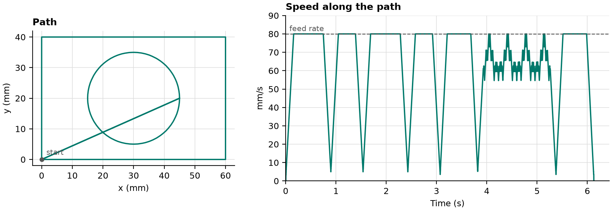
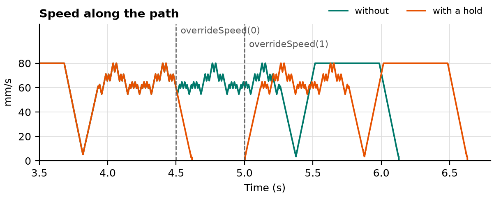

# Writing a motion planner

A machine that follows a contour (a plotter, a dispenser, a laser, a mill) gets a list of points and a
speed, and shall run through the points without stopping at each of them. The program that makes this
possible is a motion planner (1). The library does not contain one, but it runs what a planner
calculates: [`GroupPath`](group-paths.md) takes the moves of a path ahead and joins them without a stop.
{ .annotate }

1.  **Motion planner**

    A program that turns a list of coordinates and a speed along the path, the feed rate, into moves for
    the motors. It looks ahead over the coming moves, decides how fast each point can be passed, and
    gives every move its speeds.

This chapter shows how a planner is built on the library, with the examples `advanced/PathPlanner` and
`advanced/CoreXY`. Their planner is a single header of about 300 lines, `Planner.h`, in the folder of
each sketch. It is example code, made to be read, copied and changed.

## The example

```cpp
--8<-- "advanced/PathPlanner/PathPlanner.ino"
```

The sketch describes the machine (two motors, their limits, 100 steps per mm), lists the points of the
path in mm, and lets the planner calculate the speeds with `plan()`. `runner.giveMoves()` in `loop()`
hands the moves to the library.

<figure markdown="span">
  <figcaption>The path of the example (left) and the speed along it (right), as the library runs it: nearly a stop at each corner of the rectangle, 55 mm/s and more on the circle. The curves of this chapter are the output of the example's planner and the library, not drawings.</figcaption>
</figure>

## What the planner does and what the library does

| The planner (`Planner.h`) | The library (`GroupPath`) |
|---|---|
| converts the points from mm to steps of the motors | moves the motors on a straight line to these steps |
| decides how fast each point can be passed | passes the point at that speed and goes on with the next move |
| gives each move its highest speed and its acceleration, in mm | converts them for the motors and makes the ramps |
| hands the moves over in time | keeps one move waiting behind the one that runs |

The planner works in four steps, which the following sections describe: from the points to the motors,
the limits of each segment (1), the speed at each junction (2), and the look-ahead over the whole path.
{ .annotate }

1.  **Segment**

    The straight piece of the path between two points. Each segment becomes one move of the group.

2.  **Junction**

    The point where two segments meet.

## From the points to the motors

The points of a path are given in the coordinates of the machine, here x and y in mm. The library moves
motors, in steps. How the positions of the motors follow from the coordinates is the kinematics (1) of
the machine. The example describes it as one factor for each pair of motor and axis:
{ .annotate }

1.  **Kinematics**

    The relation between the coordinates of a machine and the positions of its motors. On an x-y table
    with one motor for each axis it is the number of steps per mm. On other machines a motor moves
    several axes at once.

```cpp
// one motor for each axis: 100 steps per mm in x, 100 in y
planner::Kinematics table = planner::Kinematics::plain({100, 100});

// CoreXY: motor A = x + y, motor B = x - y
planner::Kinematics coreXY = planner::Kinematics::coreXY(100, 100);
```

This form covers every machine whose motors follow from the axes by multiplication and addition. On such
a machine a straight line of the axes is a straight line of the motors, which is what a group of the
library moves on. A machine without this property (a robot arm, a delta printer) needs its lines cut
into short segments by the planner.

For every point, the planner calculates the targets of the motors from the point itself and rounds them
to steps (`Path::add()`). It does not add up the ways of the segments, so the rounding errors do not add
up along the path either.

The planner also keeps the length of each segment in mm. This is what the library needs to take the
speeds of a move in mm/s, see [A move and its speeds](group-paths.md#a-move-and-its-speeds): the planner
never converts a speed to steps of a motor.

## The limits of a segment

Along a segment every motor runs at a fixed share of the speed of the path: the steps it makes per mm of
the path. A motor of the example that makes 100 steps per mm of a segment in x runs at 8,000 steps/s
when the path runs at 80 mm/s. On a diagonal at 45° both motors make 70.7 steps per mm of the path.

From these shares the planner derives two limits for each segment (`Path::add()`):

- **The highest speed** is the feed rate, or less if a motor would exceed its maximum speed.
- **The acceleration** along the path is as high as the motors allow in this direction. With motors of
  50,000 steps/s², the example accelerates at 500 mm/s² along x and at 707 mm/s² on a diagonal, where
  both motors work.

## The speed at a junction

Where two segments meet, the direction of the path changes at once. The speed of every motor jumps: at
a corner of 90° from x to y, the x motor goes from the full speed of the path to standstill, and the y
motor from standstill to the full speed.

A stepper motor follows such a jump without a ramp only up to a certain size, about its
[pull-in speed](../motor-settings.md#motion-settings). The planner takes this size for each motor as
`maxJump` and passes a junction as fast as the jumps of all motors allow (`Path::plan()`, step 1):

| Junction of the example | Largest jump of a motor | Speed at the junction with `maxJump` = 500 steps/s |
|---|---|---|
| Corner of the rectangle, 90° | 100 steps/s for each mm/s of the path | 5 mm/s |
| Two segments of the circle, 5° | about 9 steps/s for each mm/s of the path | about 55 mm/s |
| Two segments on one line | none | the speed of the segments |

Two things make a contour faster: a higher `maxJump`, as far as the motors follow it without losing
steps, and smaller angles between the segments. A circle of 36 segments is run at about 30 mm/s with the
values of the example, the circle of 72 segments at 55 mm/s.

!!! warning "Find `maxJump` by trial"
    The jump a motor follows depends on the motor, its driver and current, and on the load. Start with
    the pull-in speed at which the motor starts reliably, and raise the value only as far as the machine
    runs the path without losing steps.

## Looking ahead

The speed at a junction is not only limited by the junction itself. The path has to be able to slow down
for what comes later: for a sharp corner three short segments ahead, or for the end of the path. The
planner therefore goes over the whole path twice (`Path::plan()`, steps 2 and 3):

1. **Backward, from the end.** The path ends at standstill. Each junction may be at most as fast as the
   segment behind it can brake from, down to the speed of the next junction.
2. **Forward, from the start.** The path starts at standstill. Each junction may be at most as fast as
   the segment before it can accelerate to.

After these two passes every segment has a speed at its start, a speed at its end and a highest speed,
and each of them can be reached with the acceleration of the segment. The example plans with the whole
acceleration of the motors; the library runs such a plan without a warning.

## Giving the moves to the library

One move of the path runs in the library and one waits. `PathRunner::giveMoves()` hands over the next
segments as long as `room()` of the `GroupPath` reports room, each with its length, its highest speed,
its speed at the end and its acceleration:

```cpp
advanced::PathMove move;
move.length        = segment.length;        // mm
move.speed         = segment.vMax;          // mm/s
move.speedAtTarget = segment.vOut;          // mm/s
move.acceleration  = segment.acceleration;  // mm/s²
moves.add(segment.target, 2, move);         // targets of the motors in steps
```

- **In time.** The next move has to be there before the move that runs arrives. `loop()` therefore has to
  come by more often than the shortest segment takes: a segment of the example's circle takes about
  20 ms. If the move is late, the group runs on along its line until it comes, see
  [Rules](group-paths.md#rules).
- **From `loop()` or from the interrupt.** Preparing a move takes about 3 µs on a Teensy 4.1 and 35 µs
  on a Teensy 3.6. Called from `loop()`, as in the example, it delays no step. A sketch whose `loop()` is
  too slow can give the moves in the function of [`onRoom()`](group-paths.md#onroom) instead, at the
  price of that time in the step interrupt.

## Override and hold

A path that is planned for its speeds can be run slower at every point, so the planner has nothing to
calculate for these two functions of the library:

```cpp
runner.moves.overrideSpeed(0.5f); // the path at half its speeds
runner.moves.overrideSpeed(0);    // hold: brake along the path and stand on it
runner.moves.overrideSpeed(1);    // go on at the planned speeds
```

<figure markdown="span">
  { width="620" }<figcaption>A hold on the circle of the example: the group brakes through the segments that follow, stands on the path, and goes on.</figcaption>
</figure>

While the path is held, `giveMoves()` goes on as before: the group needs the following moves to brake
along the path. See [Override and hold](group-paths.md#override-and-hold) for the details, and for how
a path that is held is given up.

## Another machine: CoreXY

On a CoreXY machine two motors move the head together through one belt: motor A makes the sum of the
ways in x and y, motor B their difference. A move along x turns both motors, and on a diagonal only one
of them turns. For the planner this is another kinematics and nothing else; the points of the path stay
in x and y:

```cpp
--8<-- "advanced/CoreXY/CoreXY.ino"
```

The limits follow from the kinematics by themselves. Along x and y both motors share the work, so the
head accelerates at 625 mm/s² with the values of the sketch (1); on a diagonal one motor does it alone,
at 442 mm/s². The sketch also shows override and hold from the serial monitor.
{ .annotate }

1.  **Where the numbers come from**

    A motor accelerates at 50,000 steps/s². Along x each motor makes 80 steps per mm of the path:
    50,000 / 80 = 625 mm/s². On a diagonal one motor makes 113 steps per mm of the path (80 × √2), the
    other none: 50,000 / 113 = 442 mm/s².

## What the example does not do

- **Arcs and curves.** The planner knows straight segments only. A curve is cut into short segments by
  the sketch, as the circle of the example.
- **A limit of the jerk.** The acceleration changes at once, as in all ramps of the library.
- **Planning while the path runs.** The whole path is planned before it starts. A planner that takes
  points from a host while it runs (G-code) plans a window of segments and keeps the path able to stop
  at the end of what it knows.
- **Speeds above the plan.** The override reaches up to 1. A faster run needs a new plan.

## The planner of the example

??? example "Planner.h"

    ```cpp
    --8<-- "advanced/PathPlanner/Planner.h"
    ```
