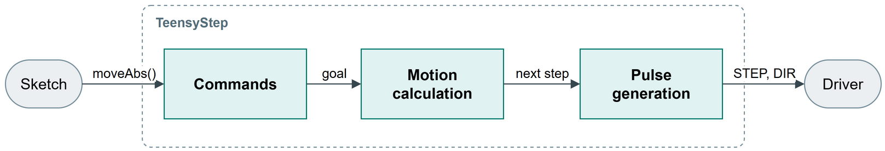
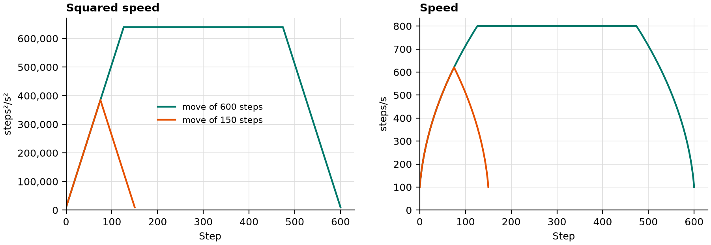
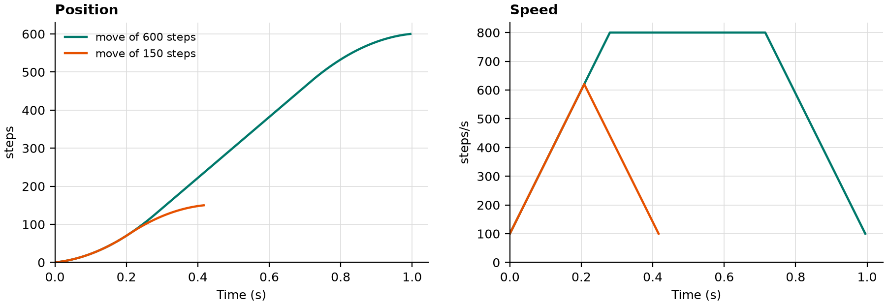
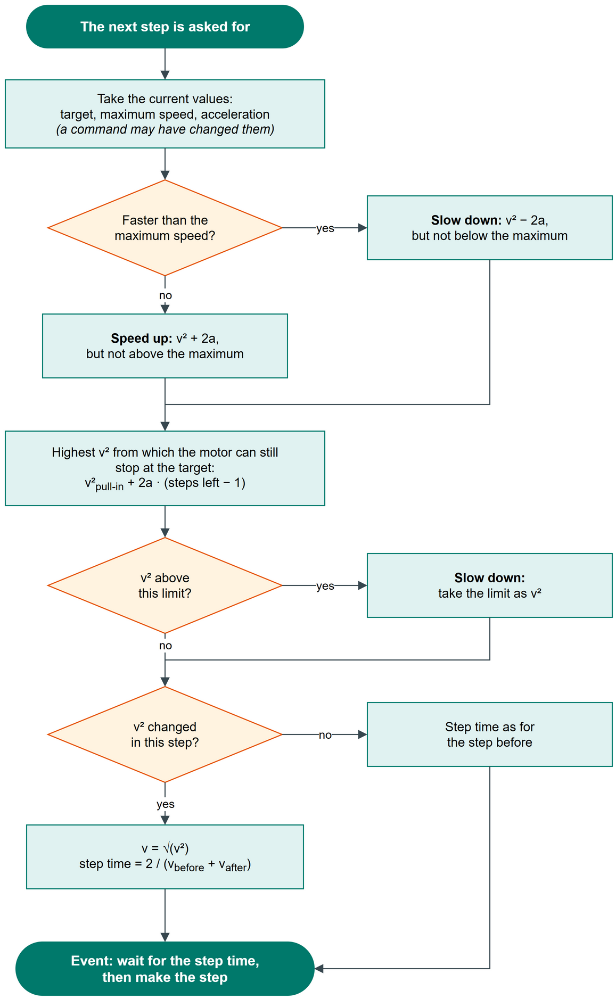
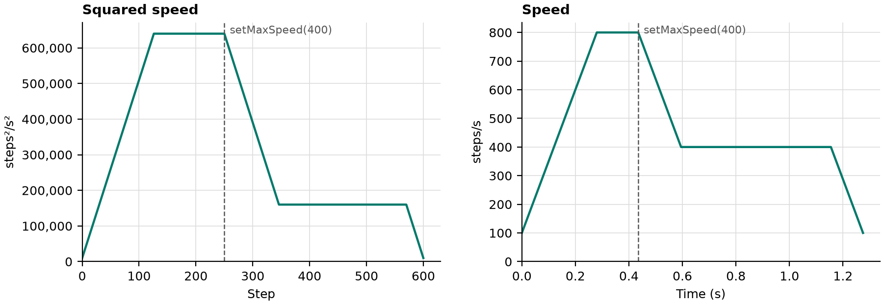

# Behind the scenes

This chapter explains how the library works inside: how a command becomes step pulses, how the ramp is
calculated, what the hardware timers do, and how a group keeps its motors synchronized. Nothing of it is
needed to use the library. It is written for readers who want to know why the library behaves as it
does, or who want to read its source code.

## The three parts of the library

The library consists of three parts with separate tasks:

| Part | Task | Folder of the source |
|---|---|---|
| **Commands** | The classes a sketch uses, `Stepper` and `StepperGroup`. They check a command and start the move | `src/api/` |
| **Motion calculation** | Works out the motion: at which time the next step has to be made, and in which direction | `src/core/` |
| **Pulse generation** | Switches the STEP and DIR pins at the calculated times, with a hardware timer of the processor | `src/backend/` |

<figure markdown="span">
  <figcaption>The way of a command through the three parts of the library.</figcaption>
</figure>

The motion calculation is arithmetic only: it works with positions, speeds and times and never touches
a timer or a pin. The pulse generation is the only part that depends on the processor. It exists once
for Teensy 4.0, 4.1 and MicroMod and once for Teensy 3.5 and 3.6, and the compiler takes the one that
fits the board. Further processors can be added later without a change to the other two parts.

## From a command to a step

### A motor that stands still

A `Stepper` object that stands still is only a few numbers in memory: its pins, its settings (maximum
speed, acceleration, ...) and its position. It uses no timer and no processor time. A sketch can
therefore have any number of `Stepper` objects.

### The active move

When a motor is told to move, the library needs a place for everything that belongs to this move while
it is under way. This chapter calls that place an **active move**. It holds:

- which motor moves (for a group: which motors),
- the state of the motion calculation: where the motor is now, how fast it is, and where it shall go,
- which hardware timer makes the pulses of this move.

The library has room for 16 active moves. A single motor that moves needs one of them. A group that
moves also needs only one, however many motors it has, because its motors are calculated together. This
is where the limit "16 motors or groups at the same time" comes from.

The number 16 is the size of a table that is fixed when the library is compiled, so that the library
needs no dynamic memory. It is a choice, not a property of the hardware: a Teensy 4.x happens to have
16 timers the library can use, a Teensy 3.5 or 3.6 has 20 compare channels, and both get the same 16
active moves. A build that needs fewer can make the table smaller, see
[Compile-time settings](reference/errors.md#compile-time-settings).

(In the source code an active move is called a `Channel`. The word is avoided here, because the hardware
timers have channels as well, and the two are different things.)

### What a move command does

Take `motor.moveAbsAsync(4000)` for a motor that stands still:

1. **The command reserves an active move** and looks for a hardware timer that is free. If all 16 active
   moves are taken, or if no timer is free, the command cannot be executed: it returns the error
   `noTimer`, and the motor stays as it was.
2. **The command copies the motor into the active move:** its settings and its current position. Then
   it gives the motion calculation the goal: "go to position 4000 and stop there".
3. **The command starts the timer** and returns. `loop()` runs on.

From this moment the move runs by itself, in the interrupt of the timer. The sketch is not involved
any more, unless it gives a new command.

A command for a motor that is **already moving** needs none of the three steps: the motor has its
active move and its timer already. The command only changes the goal in the active move, and the next
step is calculated for the new goal.

### What happens at every step

The timer is set to the time at which the next step has to be made, its *due time*. A step then takes
two interrupts of the timer:

| Interrupt | What the pulse generation does |
|---|---|
| at the due time of the step | 1. It sets the STEP pin to its active level: the step pulse begins.<br>2. It sets the timer to the end of the pulse.<br>3. It asks the motion calculation: **"what is next?"** The calculation answers with the next *event* (see below): how long to wait, and whether to step then. |
| at the end of the pulse | 4. It sets the STEP pin back: the pulse ends.<br>5. It sets the timer to the due time of the next event. |

Then the same happens again, step after step. The next event is calculated while the pulse of the
current step is on; [The step pulse](#the-step-pulse) describes the two interrupts in detail. Two points
are worth noting:

- **The pulse generation asks, once for every event; the motion calculation never acts by itself.** It
  only answers when it is asked, and it calculates exactly one step ahead. There is no list of prepared
  steps.
- **Only the next step is calculated in the interrupt.** There is no planning of the whole move, neither
  here nor anywhere else; how the next step is found is the subject of
  [the next section](#how-the-ramp-is-calculated).

An *event* is the answer of the motion calculation. It contains:

| Part of the event | Meaning |
|---|---|
| a delay | how long to wait after the previous event |
| the motors that step | for a single motor: step or do not step. For a group: which of its motors step |
| their directions | up or down, for each motor that steps |
| "target reached" | set at the step that reaches the target; the arrival function of the sketch is then called |

### Where the position is during a move

While the motor moves, its position is counted in the active move: every event that makes a step also
counts it. `getPosition()` and `getSpeed()` of a moving motor read the values there, so they are
current at every moment, not only at the end. Since the next step is calculated while the pulse of the
current one is made, the position read can be one step ahead of the pulses.

### The end of a move

When the motor has reached its target and stands still, the motion calculation answers "nothing more".
The pulse generation then stops the timer and puts its registers back as they were, so that the timer
is free again: for the next move, for PWM, or for another library. The final position is copied from
the active move into the `Stepper` object, and the active move is free for the next command.

## How the ramp is calculated

Many stepper libraries plan a move when it starts: so many steps of acceleration, so many at constant
speed, so many of deceleration. A plan has to be thrown away when something changes on the way.

TeensyStep makes no plan. **For every step, the motion calculation decides anew** from three things:
where the motor is, how fast it is, and what the goal is (a position with the speed to have there, or a
speed). The decision for one step is always one of: go faster, keep the speed, go slower.

The decision is made with the values that hold at that moment. If the sketch has changed the target,
the maximum speed or the acceleration since the previous step, the new values are used. A command can
therefore be given at any time, and the motor adjusts to it from the next step on.

### The rule for one step

The rule behind the decision is the formula for constant acceleration. For a motor that has the speed
vₙ after step n and accelerates with the acceleration a, it gives the speed vₙ₊₁ after the next step:

```
vₙ₊₁² = vₙ² + 2a
```

(In general the formula reads v² = v₀² + 2as for a distance s; here the distance is one step, s = 1.)
It says: **with every step, the square of the speed changes by twice the acceleration.** The motion
calculation therefore remembers the squared speed of the motor. To accelerate for one step it adds 2a
to this number; to decelerate it subtracts 2a.

### An example

A motor with the default settings: maximum speed 800 steps/s, acceleration 2,500 steps/s², pull-in
speed (1) 100 steps/s. It is told to move 600 steps.
{ .annotate }

1.  **Pull-in speed**

    The speed up to which the motor can start and stop at once, without a ramp. See
    [Motor settings](motor-settings.md).

The motor starts at the pull-in speed, so the squared speed starts at 100² = 10,000. Every step of
acceleration adds 2 · 2,500 = 5,000:

| After step | Squared speed | Speed (its square root) |
|:---:|:---:|:---:|
| start | 10,000 | 100 steps/s |
| 1 | 15,000 | 122 steps/s |
| 2 | 20,000 | 141 steps/s |
| 3 | 25,000 | 158 steps/s |
| ... | | |
| 126 | 640,000 | 800 steps/s: the maximum speed is reached |

From step 127 on the motor keeps its speed. But when does it have to slow down? The same arithmetic
answers this. To get from 800 steps/s back down to 100 steps/s, the squared speed has to fall from
640,000 to 10,000, by 5,000 per step: that takes 126 steps. So at every step the calculation compares:

- more than 126 steps left to the target: keep the speed (or accelerate, if the maximum is not reached),
- 126 steps left: start to decelerate.

The motor decelerates from step 475 on, arrives at the target at the pull-in speed and stops there.

If the move is too short to reach the maximum speed, the same comparison makes the motor turn from
accelerating to decelerating in the middle, without a special case. A move of 150 steps accelerates for
75 steps, up to 620 steps/s, and decelerates for the other 75.

<figure markdown="span">
  <figcaption>Squared speed (left) and speed (right) over the steps, for the move of 600 steps and for one of 150 steps. The squared speed changes along straight lines, by 5,000 per step; the speed is its square root. The curves of all graphs of this chapter are the output of the motion calculation of the library, not drawings.</figcaption>
</figure>

The time to wait for a step follows from the speed: the step takes one divided by the mean of the speeds
at its beginning and its end. The first step of the example takes 1 / 111 s, about 9 ms; a step at the
maximum speed takes 1 / 800 s = 1.25 ms.

With these times, the same two moves look as ramps are usually drawn, over the time instead of over the
steps. A squared speed that changes by the same amount with every step is a speed that changes by the
same amount in every unit of time: the ramp is linear, with the acceleration that was set.

<figure markdown="span">
  <figcaption>Position (left) and speed (right) over the time, for the same two moves. The move of 600 steps takes 1.0 s, the one of 150 steps 0.42 s.</figcaption>
</figure>

### Speeds between the steps of 2a

In the example the numbers fit: from 10,000 up to 640,000 it is exactly 126 times 5,000. In general
they do not fit. With a maximum speed of 750 steps/s the squared speed has to reach 562,500, and that
is 110.5 times 5,000 above the start. A calculation that knew only "plus 2a" and "minus 2a" could never
get to this speed; it would have to swing around it.

The motion calculation therefore limits every change: **a step that would pass a limit ends exactly at
the limit.** With the maximum speed of 750 steps/s:

| After step | Squared speed | |
|:---:|:---:|---|
| 109 | 555,000 | |
| 110 | 560,000 | |
| 111 | 562,500 | only 2,500 are added: exactly 750 steps/s |
| 112 | 562,500 | constant from here on |

The speed is then constant; it does not swing. The same is done on the way down. The limit there is
the highest squared speed from which the motor can still stop at the target, which falls by 2a with
every step that brings the motor closer. In the move with 750 steps/s the first step of the
deceleration takes off only 2,500 (from 562,500 to 560,000), and all further ones 5,000, so that the
motor arrives at the target with exactly the pull-in speed.

The step time takes this into account: in a step that changes the squared speed by less than 2a, the
speed changes during a part of the step only and is constant for the rest of it.

### The decision as a flow chart

<figure markdown="span">
  { width="520" }<figcaption>The decision for one step of a move to a target at which the motor stops. v² is the squared speed after the step.</figcaption>
</figure>

The chart shows the usual case. Left out are: a deceleration of its own (`setDeceleration()`; the chart
uses the acceleration for both), the first step from standstill, a motor that moves away from its
target or is too fast to stop there (it brakes first and comes back), targets with a speed, and the
waits for long step times.

### Why a new command needs nothing special

Suppose the sketch calls `motor.setMaxSpeed(400)` while the motor of the example runs at 800 steps/s,
after step 250. Nothing is planned again. At the next step the calculation finds that the motor is
faster than allowed and subtracts 5,000 from the squared speed, step after step, until 400 steps/s are
reached at step 346. From 400 steps/s the motor needs only 30 steps to stop, so it also starts to
decelerate later: at step 571 instead of step 475.

<figure markdown="span">
  <figcaption>The move of 600 steps, with <code>setMaxSpeed(400)</code> called after step 250: squared speed over the steps (left) and position over the time (right).</figcaption>
</figure>

The same holds for a new target or a new acceleration: they are new inputs of the next decision.

### Details

- The squared speeds are kept as whole numbers, so that no rounding errors add up over a long ramp.
- A step on a ramp needs one square root, to get the speed from its square, and one division, to get
  the step time from the speed. All supported processors have a floating point unit that does both in
  hardware, in about 14 clock cycles each: about 25 ns on a Teensy 4.x at 600 MHz, about 80 ns on a
  Teensy 3.6 at 180 MHz. (These are estimates from the documentation of the processors, not
  measurements.)
- At constant speed nothing of this is calculated: the time of the last step is used again.

What this method gives:

- **Changes at any time.** A new target, a new maximum speed or a new acceleration is simply a new
  input for the next decision. There is no plan that has to be repaired.
- **Targets with a speed** and the run-up they may need come from the same decision.

The price is processor time: a decision per step costs more than reading a prepared plan. Measured on a
Teensy 4.1, a step costs about 1 µs of processor time in all, and a step on a ramp about 0.5 µs more;
the square root and the division are a small part of that. [Performance](advanced/performance.md) has
the numbers.

## The timers

### One compare channel for each active move

The word *timer* is used for different things. In this chapter a **timer** is one counter together
with its compare registers, and a **compare channel** is one compare register with its interrupt.
(The reference manuals of the processors use their own words: the four independent timers of a
QuadTimer module are called "channels" there.)

Every active move has one compare channel for itself. The library uses it only as a clock: the counter
runs freely, and the compare register raises an interrupt when the counter reaches its value. The pins
are not connected to the timer; the interrupt writes them as ordinary digital outputs. This is why any
pin can be a STEP or DIR pin, and why a group can step up to 16 pins from one compare channel.

The two processor families differ:

| | Teensy 4.0, 4.1, MicroMod | Teensy 3.5, 3.6 |
|---|---|---|
| Timers | 16: each of the QuadTimer modules TMR1 to TMR4 holds four independent timers, every one with its own 16-bit counter | 4: the FlexTimers FTM0 to FTM3, every one with one 16-bit counter |
| Compare channels | 16: one for each timer (the library uses one compare register of a timer) | 20: the timers have 8, 2, 2 and 8 of them, on the one counter of the timer |
| An active move takes | a whole timer | one compare channel; the other channels of the timer stay free for PWM and for other moves |
| Counter | set up by the library: it counts the bus clock (150 MHz) without a reload and runs around every 437 µs | not touched: it stays as the Teensy core has set it up for PWM (`analogWrite`), counting from 0 to its top value 488 times per second |
| Interrupts | one for each module, shared by its four timers | one for each timer, shared by its channels |
| Longest time for one event | 400 µs | 1 ms |

On Teensy 3.5 and 3.6 the counters are left alone on purpose: the other channels of the same timer keep
making PWM with unchanged frequency. The price is arithmetic modulo the top value of the counter
instead of modulo 2^16.

### Finding a free compare channel

Compare channels are not reserved when the sketch starts. At the beginning of every move the library
looks for one that nobody uses, by reading the hardware:

- A compare channel whose interrupt is enabled, or that runs in a mode the Teensy core does not set,
  belongs to somebody else and is skipped.
- A compare channel whose pin is switched to PWM is skipped. Its neighbours are not: on a Teensy 4.x
  the PWM of a pin has a timer with a counter of its own, and on a Teensy 3.5 or 3.6, where the
  channels of a timer share the counter, the library never writes to the counter and so cannot disturb
  the PWM of the other channels.
- All compare channels behind an interrupt that another library has taken are skipped: the four timers
  of a QuadTimer module, or all channels of a FlexTimer.
- On Teensy 3.5 and 3.6 a timer is skipped as a whole if its counter cannot be used as it is: it counts
  an encoder, or its PWM frequency was raised so far that it runs around in less than 1.2 ms.

Compare channels that cannot make PWM on any pin of the board are taken first (they exist on Teensy 4.x
only, for example the four timers of TMR4), then those whose PWM pin is a pin of the motor itself, then
the others. Before the library changes a compare channel, it stores its registers; when the move ends,
it writes them back. [Timers and interrupts](advanced/timers.md) lists the channels, their pins and
the rules for PWM and other timer libraries.

### Due times

Every event has a *due time*, a value of the counter. The interrupt at the due time executes the event,
gets the next event and sets the compare register to the next due time:

```
due time of the next event = due time of this event + delay of the next event     (modulo the counter range)
```

Three details keep the timing exact:

- **No drift from late interrupts.** The next due time is counted from the previous due time, not from
  the moment the interrupt was served. An interrupt that is served late delays one edge and nothing
  after it.
- **No drift from rounding.** The motion calculation gives the delay in seconds, and the timer counts
  whole counts. The fraction of a count that is cut off is carried over to the next delay, so that the
  mean step rate is exact.
- **Events that are already due.** If the interrupt was served so late that the next due time has
  passed as well, the interrupt function executes that event at once, in the same call, instead of
  waiting for the counter to come around again.

### Long times with a 16-bit timer

A 16-bit counter at 150 MHz runs around every 437 µs: too short for a motor that makes one step per
second. Slowing the counter down for slow motors would make the times of fast motors coarse, and on
Teensy 3.5 and 3.6 the counter is not the library's to change.

The solution is in the motion calculation, not in the timer. The pulse generation tells it the longest
time it can wait in one event (400 µs or 1 ms, see the table above). A step period that is longer is cut
into equal pieces, and the motion calculation hands them out as events **without a step**: *waits*.
Only the last piece makes the step. For a Teensy 4.x:

| Speed | Step period | Events per step |
|---|---|---|
| 10,000 steps/s | 100 µs | 1 |
| 1,000 steps/s | 1 ms | 3: two waits of 333 µs, then the step after another 333 µs |
| 1 step/s | 1 s | 2,500 |

For the pulse generation a wait is an event like any other: it sets the compare register and returns.
Speeds down to 0.001 steps/s are built this way, with the full resolution of the timer at every speed.

The waits have a second use. At each of them the motion calculation notices a command that has arrived
in the meantime and decides the step anew; the part of the period that has already passed counts for the
new step. A motor that creeps at one step per second therefore reacts to `stop()` or to a new speed
within the longest event time, and not only at its next step a second later.

### The step pulse

A step pulse has two edges. Both are made by the same compare channel; no second timer is needed. A step therefore takes two interrupts:

| Time | The interrupt function |
|---|---|
| due time of the step | sets the STEP pins of the event to their active level; sets the compare register to the end of the pulse; calls the arrival function, if the event reaches a target; gets the next event from the motion calculation |
| due time + pulse width | sets the STEP pins back; sets the DIR pins for the next event; sets the compare register to the due time of the next event |

- **The next event is calculated while the pulse is running.** The time of the pulse is used for the
  calculation instead of being waited for. If the calculation takes longer than the pulse, the pulse is
  ended right after it, in the same call.
- **DIR changes at the end of a pulse**, for the motors that step in the next event. The driver has the
  pause until the next step to take over the new direction. Where a DIR pin really changes, the interrupt
  checks that pause against the setup time of the motor (`setDirSetupTime()`) and moves the due time of
  the next event back if it is too short; all later due times are counted from there.
- **The pause after a pulse** is at least 0.8 µs. Pulse and pause together limit the step rate: about
  170,000 steps/s with the default pulse of 5 µs.
- **Short pulses on Teensy 3.5 and 3.6.** A pulse of up to 2 µs is not worth a second interrupt there:
  the interrupt function waits for its end and makes both edges in one call.

### Several moves at the same time

Compare channels share interrupts: the four timers of a QuadTimer module on Teensy 4.x, the channels
of a FlexTimer on Teensy 3.5 and 3.6. When several compare channels of one interrupt are due together,
the interrupt function first makes the edges of all of them and only then does the rest of the work,
one move after the other. Otherwise the edge of one motor would wait for the calculation of another.

All step interrupts have the same priority (48, unless the sketch sets another one with
`advanced::setInterruptPriority()`: above the default of 128, below the millisecond interrupt of the
Teensy core). They do not interrupt each other. A step of one move that becomes due
while the interrupt of another move is being served is therefore made a little late, by up to the
time one event takes; because of the due times this does not add up.
[Performance](advanced/performance.md) has measured values.

### An emergency stop

`emergencyStop()` does not wait for the next event. It switches the interrupt of the compare channel
off and releases the channel. A pulse that has begun is completed.

The position counter then needs a correction. The motion calculation is always one event ahead of the
pins (see [What happens at every step](#what-happens-at-every-step)): while the timer waits for the
due time of a step, this step is calculated already, and it is counted in the position already. The
emergency stop discards the prepared step. No pulse is made for it, so the library takes it off the
position counter again.

After an emergency stop the position counter is therefore exactly the number of step pulses that went
to the driver. A homing routine can rely on this: a motor that runs below its pull-in speed stands
still when the pulses end, and the counter is its position. A motor that was faster may lose steps
when its pulses end without a ramp, which the library cannot know.

## Groups

### One ramp for the whole group

A group does not run a ramp per motor. The member that has to make the most steps in the move is the
*lead motor*. Only the number of steps counts for this, not a distance: the members may have different
step sizes, and one of them may be a rotary axis.

The ramp of the group is calculated for the lead motor alone, by the same code that calculates a single
motor: to the motion calculation the group is one motor that moves by the number of steps of the lead
motor. The times at which the other members step are derived from the steps of the lead motor (see
[below](#distributing-the-steps-bresenham)). Everything said in
[How the ramp is calculated](#how-the-ramp-is-calculated) holds for a group as well. A group needs one
active move and one compare channel, whether it has 2 or 16 members.

### The limits of the ramp

The ramp of the lead motor has to be slow enough for every member. A member that makes fewer steps than
the lead motor moves slower in the same proportion, so each of its limits allows the lead motor more:

```
limit for the lead motor from one member = limit of the member × (steps of the lead motor / steps of the member)
```

The ramp gets the smallest of these values over all members, separately for the maximum speed, the
acceleration, the deceleration and the pull-in speed. A member that does not move sets no limit. The
speed factor of the group (`StepperGroup::overrideSpeed()`) is applied to the maximum speed found this way.

Example: x makes 4,000 steps and y 1,000, so x is the lead motor. Both motors allow 800 steps/s. x
allows the lead motor 800 steps/s, y allows it 800 × 4 = 3,200 steps/s. The ramp runs up to 800 steps/s;
x then runs at 800 and y at 200 steps/s. If y allowed only 100 steps/s, the ramp would run up to
100 × 4 = 400 steps/s: x at 400 and y at 100 steps/s.

### Distributing the steps: Bresenham

At every step of the lead motor, the group decides for each other member whether it steps as well. The
method is [Bresenham's line algorithm](https://en.wikipedia.org/wiki/Bresenham%27s_line_algorithm),
which was invented to draw straight lines on a grid of pixels.

Every member has a counter, the *error*. At each step of the lead motor, the number of steps of the
member is added to it. When the error reaches the number of steps of the lead motor, the member makes a
step and that number is subtracted. Only whole numbers are added and compared, so nothing can drift.

Example: the lead motor makes 5 steps, and a member has to make 2. The error of the member starts at
half the steps of the lead motor (as a whole number: 2), so that the member steps in the middle of its
intervals:

| Step of the lead motor | 1 | 2 | 3 | 4 | 5 |
|---|:---:|:---:|:---:|:---:|:---:|
| Error after adding 2 | 4 | 6 | 3 | 5 | 2 |
| Reaches 5: the member steps | | yes | | yes | |
| Error after the step | 4 | 1 | 3 | 0 | 2 |
| Position of the member | 0 | 1 | 1 | 2 | 2 |
| Exact position on the line | 0.4 | 0.8 | 1.2 | 1.6 | 2.0 |

The position of the member is the exact position rounded to the nearest whole step: no member is ever
more than half a step away from the line. The lead motor is treated in the same way; for it the rule
gives a step every time.

The two tasks are separate: the ramp decides **when** the next step of the lead motor is made, Bresenham
decides **who** steps with it. The result is one event with a delay and one bit per member. That is why
a group stays synchronized while it accelerates, when its speed is changed, and when it is stopped
early: all of these change only the "when".

A member always steps at the same moment as the lead motor. A member that is only a little slower than
the lead motor therefore does not step evenly: it steps with the lead motor and leaves a step out from
time to time.

### Rotating groups

A group that rotates with a fixed speed ratio uses the same mechanism. The speeds take the place of the
step counts: the fastest member is the lead motor and gets the fixed number 2^30, and every other member
gets its share of that number according to its speed. The motion calculation runs the lead motor at a
speed instead of to a target, so the move never ends. The ratios are therefore kept with a resolution of
1 in 2^30, and they are kept exactly while the group accelerates or reverses, because again only the
"when" changes.

## Why the lists in braces

Groups and their commands are written with lists in braces:

```cpp
StepperGroup xy{x, y};
xy.moveAbs({4000, 1000});
```

In the declarations of the library such a list is a `std::initializer_list<...>`. The reasons for this
design:

- **Any number of values.** A list in braces can have 2 entries or 16. Without it the library would
  need a function for every number of motors, or the sketch would have to fill an array first.
- **No dynamic memory.** The compiler builds the list on the stack when the function is called, and it
  is gone afterwards. Nothing is allocated with `new` or `malloc`. The group copies what it needs into
  a fixed array of 16 entries.
- **Readable.** The values of the members stand side by side in the order of the members, like the
  coordinates of a point.

A list of motors is declared as `std::initializer_list<std::reference_wrapper<Stepper>>`. The inner
type exists for a technical reason: C++ cannot make a list of references, and a list of `Stepper` would
be a list of *copies* of the motors. `std::reference_wrapper<Stepper>` is a reference that can be put
into a list. The compiler creates it from the name of the motor; a sketch never writes it.

The group stores only the addresses of its motors. That is why a group is a light object that can be
created for a single command, why a motor can be in several groups, and why the motors have to exist
for as long as the group is used. A move that was started does not need the group object any more:
everything it needs was copied into the active move.

The number of values in a list is checked when the command runs, against the number of members; a
wrong number returns `invalidArgument`.

A list in braces has to be written in the sketch. For values that are calculated or received at run
time, every command that takes a list also exists in a second form that takes an array and its length;
this includes the path commands of the advanced API (`advanced::GroupPath`). See
[Values in braces or in an array](reference/stepper-group.md#values-in-braces-or-in-an-array).

## Commands and the interrupt

### Protecting the data

The steps are made in an interrupt, while the sketch gives its commands in `loop()` or in an interrupt
of its own. Both work on the same active move. Every command, and every function that reads the state
of a motor, therefore disables the interrupts while it reads or changes an active move, and restores
the previous interrupt state afterwards. This takes a few microseconds; for a command that starts a
group it is longer, because the limits of the ramp are calculated in that time.

Because the interrupt state is restored and not simply enabled, the functions can also be called from
interrupts of the sketch.

A step that becomes due while the interrupts are disabled is made right afterwards. This is the reason
for the advice not to call `getPosition()` in a tight loop without need.

### Blocking commands

The blocking commands (`moveAbs()`, `stop()`, ...) are the non-blocking ones followed by a loop that
waits until the motor has arrived. While they wait, the steps are made by the interrupt as always, and
the loop calls `yield()`, so that the background tasks of the Teensy core keep running.

### The arrival function

The arrival function is called from the step interrupt, at the event that reaches the target: after
its STEP edge was made and **before** the next event is calculated. A command that the function gives
changes the goal in the active move, and the next event is already calculated for the new goal. This is
why moves can follow each other without a gap.

For the same reason an arrival function has to be short: while it runs, no step interrupt is served,
and the steps of all motors wait.

### The enable signal

The delays of `setEnable()` need no timer of their own either. The on-delay is a series of waits
that the active move hands out before its first step, and the off-delay a series of waits after the
last one. During the off-delay the active move and its compare channel are still occupied, although
`isMoving()` already returns `false`.

## Where to find it in the source

| File | Content |
|---|---|
| `src/core/Axis.h`, `Axis.cpp` | motion calculation of one motor: the decision per step, and the waits for long step periods |
| `src/core/Group.h`, `Group.cpp` | motion calculation of a group: the ramp of the lead motor (called the *path* in the source), its limits and Bresenham |
| `src/backend/Backend.h` | the interface between the pulse generation (called *backend* in the source) and the rest of the library, with the event |
| `src/backend/teensy4/`, `teensy3/` | the pulse generation of the boards: finding a compare channel, due times, the step interrupt. The comment at the top of each file describes the timing |
| `src/api/Channels.h`, `Channels.cpp` | the active moves (called *channels* in the source): reserving and releasing them, the enable signals |
| `src/api/Stepper.cpp`, `StepperGroup.cpp` | the commands of the sketch |
