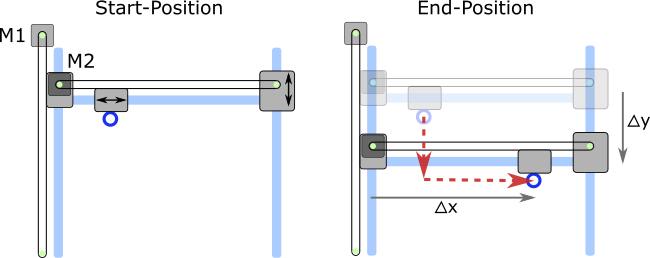

# Groups

A `StepperGroup` moves several motors synchronized: they start together, arrive together and stay on a
straight line between start and target. This chapter first compares the three ways to move more than one
motor and then describes the commands of a group.

## Three ways to move several motors

Assume a belt driven x/y transport: motor M1 moves a load in the y direction, motor M2 in the x direction.

### One after the other

The simplest way is to move the motors in sequence with blocking commands:

```cpp
M1.moveAbs(targetY); // returns when M1 has arrived
M2.moveAbs(targetX);
```



### Synchronized

To move on a straight line between the two positions, the step rates of the motors have to keep a fixed
ratio during the whole move, including the acceleration and the deceleration. This is what a group does:

```cpp
StepperGroup xy{M2, M1};
xy.moveAbs({targetX, targetY});
```


### Independent

Motors that have nothing to do with each other are simply given their own commands. They move at the same
time and each with its own ramp. A third motor M3, which brings samples to a transfer position while the
x/y transport is under way, needs nothing special:

```cpp
xy.moveAbsAsync({targetX, targetY}); // M1 and M2, synchronized
M3.moveAbsAsync(transferPosition);   // M3 on its own, at the same time

while (xy.isMoving() || M3.isMoving()) {} // wait for both
```


Every single motor and every group that moves needs one hardware timer while it moves. On a Teensy 4.x, 16
motors or groups can move independently at the same time, see
[Timers and interrupts](advanced/timers.md).

## Moving a group

```cpp
--8<-- "07_Groups/07_Groups.ino"
```

A group is created from the motors that belong to it. The targets can be given in two ways:

- **In one call**, in the order of the motors in the group: as positions with `moveAbs({...})` or as
  distances from where the motors stand with `moveRel({...})`.
- **On each motor** with `setTargetAbs()` or `setTargetRel()`, followed by `move()` of the group. A motor
  without a target stays where it is.

The members remember their targets, and the last one given wins: `moveAbs` and `moveRel` of the group
replace targets that were set on the motors before, and a target set on a motor afterwards replaces the
one from the group for the next `move()`. Since the targets are positions, a second `move()` does nothing.

As for a single motor, each command exists in a blocking form (`moveAbs`, `moveRel`, `move`, `stop`) and
a non-blocking form (`moveAbsAsync`, `moveRelAsync`, `moveAsync`, `stopAsync`).

### On the line at all times

The members of a group deviate from the straight line between start and target by at most half a step.
This holds in every phase of the move: while accelerating, at constant speed, while decelerating, and when
the group is stopped early with `stop()`. After a stop, the members stand on the line.

### Speed and acceleration of a group

Without further settings, the group moves as fast as possible without any member exceeding its own
maximum speed or acceleration. The motor with the longest way sets the pace (1); the others follow in
proportion.
{ .annotate }

1.  **Lead motor**

    The member with the most steps to make is the *lead motor* of the move. The other members step
    together with it, each at its share of the lead motor's steps. A member with a short way therefore
    steps less often, but always at the same moment as the lead motor.

A group can be given a maximum speed and an acceleration of its own:

```cpp
xy.setMaxSpeed(2'000).setAcceleration(10'000);
xy.moveAbs({4'000, 1'000}); // x runs at 2000 steps/s, y at 500
```

- The values are those of the lead motor, in steps/s and steps/s², as for a single motor.
  `setDeceleration()` sets a separate value for decelerating.
- The settings of the motors stay the upper limits. If a member would have to exceed its own maximum
  speed or acceleration, the group is slower, and the warning `speedLimited` or `accelerationLimited` is
  reported. Set each motor to what it can do, and the group to what the move shall do.
- 0 removes a value: the group is then again as fast as its members allow.
- `getSpeed()` returns the current speed of the group, that of its lead motor.

The speed and the acceleration of the group and of its members can be changed while the group moves; the
group then changes its speed as a whole.

The values belong to the group object. A group that is created for one move takes them in the same
statement: `StepperGroup{y, z}.setMaxSpeed(1'000).moveAbs({0, 0});`

### Groups are light objects

A group is only a list of motors. It can be defined once, like the motors, or created where it is needed:

```cpp
StepperGroup{y, z}.moveAbs({0, 0});
```

A move that was started goes on when the group object no longer exists.

A motor can be a member of several groups, and it can still be moved on its own. But it can only do one
thing at a time: while it moves in a group, commands for another group with this motor and move commands
for the motor itself return the error `motorBusy`. `stop()` and `emergencyStop()` of a member stop its
whole group.

### The arrival function of a group

`group.onArrival(function)` registers a function that is called when the group has reached its targets.
Like the [arrival function of a motor](targets-with-speed.md#the-arrival-function) it is called from an
interrupt.

## Passing targets without a stop

Like a single motor, a group can have a [speed at its targets](targets-with-speed.md). It is the optional
parameter after the targets, and it is the speed of the lead motor, like the speed of the group:

```cpp
xy.moveAbsAsync({10'000, 0});      // stop at the targets
xy.moveAbsAsync({10'000, 0}, 500); // pass them at 500 steps/s and run on along the line
```

The group passes its targets at this speed and runs on along the line until the next command. The next
move can be given at once, in most cases from the arrival function. It starts where the motors are, so
the group goes through the point without a stop:

```cpp
--8<-- "08_GroupWaypoints/08_GroupWaypoints.ino"
```

!!! warning "The speeds of the motors jump at such a point"
    Within each move the motors stay on a straight line. Where two moves meet, the direction of the line
    changes, and with it the speed of every single motor, without a ramp. In the sketch above, y starts
    at 500 steps/s when the group passes the first point. Choose the speed at these points low enough for
    the motors to follow (1), and cut a sharp corner into short moves. The library does not plan ahead
    across the moves and does not round corners.
    { .annotate }

    1.  **How low**

        A motor can change its speed without a ramp by about its pull-in speed, see
        [Motor settings](motor-settings.md). On a straight continuation, where the direction of the
        line does not change, the speed can be as high as the motors run.

The rules for these moves:

- **New targets** are accepted when the group stands still and when it has passed its targets and runs
  on. In the middle of a move, other targets return the error `notSupported`.
- **The speed at the targets can be changed during the move**, by giving the same targets again with
  another speed. `xy.moveAbsAsync({10'000, 0});` turns the move above into one that stops at its targets.
- **No run-up.** A single motor reverses and takes a run-up if a target is too close for its speed. A
  group never leaves its line: if the way is too short to reach the speed, or to slow down to it, the
  group arrives as close to the speed as it can and changes to it behind the targets. The move command
  then returns the warning `targetSpeedNotReached`. A move that shall stop at its targets, but is too
  short for it, passes the targets, stops and returns to them along the line.
- **Blocking moves** with a speed (`moveAbs`, `moveRel`, `move`) return when the group passes its targets.
- **After `stop()`** within a move, the same targets continue it.

### The speed at the start of a move

A move that follows another one starts at the speed the group has: the new lead motor starts at the
speed the old one had. A third parameter sets this speed explicitly:

```cpp
xy.moveAbsAsync({10'400, 8'000}, 500, 300); // start this move at 300 steps/s, pass its targets at 500
```

This parameter is meant for programs that calculate a path, for example a motion planner (1). Sketches
that give a few waypoints do not need it.
{ .annotate }

1.  **Why a planner needs it**

    A planner thinks in the speed along the path, for example in mm/s. The library measures the speed
    of a group at its lead motor, and the lead motor can change from one move to the next. At a corner
    the same speed along the path is therefore a different number for the move before and the move
    after it. The planner converts its speed for each move: speed along the path × steps of the lead
    motor / length of the move.

## Rotating a group

`rotateAsync()` runs the members at the given speeds. The ratio of the speeds is kept exactly at all
times, also while the motors accelerate, decelerate or reverse:

```cpp
--8<-- "13_SyncRotation/13_SyncRotation.ino"
```

- A further `rotateAsync()` with speeds of the same ratio changes the speed of the group. Another ratio
  is refused with `notSupported` while the group rotates.
- `overrideSpeed(factor)` runs the group at `factor` times the speeds given to `rotateAsync()`. A negative
  factor reverses all members; 0 stops the group, and a later factor starts it again.

For a ratio that changes while the motors run, use independent motors and adjust the speed of one of
them, as the example `15_Winder` does.
