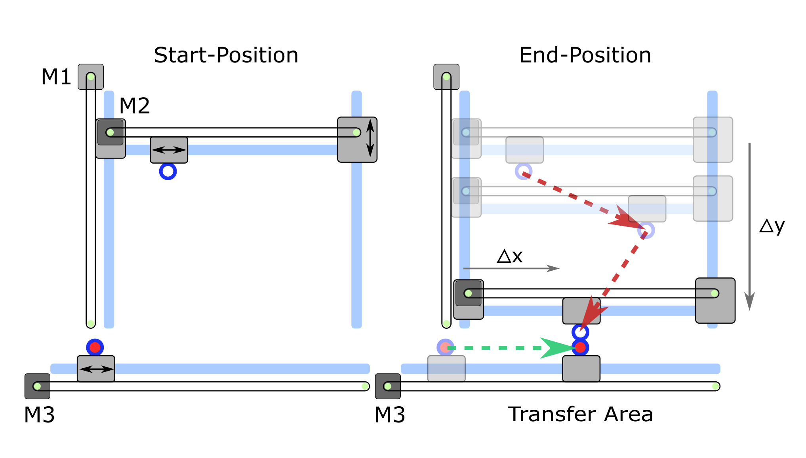

# Groups

A `StepperGroup` moves several motors synchronized: they start together, arrive together, and their speeds
keep a fixed ratio during the whole move. Motors that drive an x/y transport, for example, move their
load on a straight line. This chapter first compares the three ways to move more than one motor and then
describes how a group is defined and moved.

## Three ways to move several motors

Assume a belt driven x/y transport: motor M1 moves a load in the y direction, motor M2 in the x direction.

### One after the other

The simplest way is to move the motors in sequence with blocking commands:

```cpp
M1.moveAbs(targetY); // returns when M1 has arrived
M2.moveAbs(targetX);
```


### Synchronized

To move on a straight line between the two positions, the step rates of the motors have to keep a fixed
ratio during the whole move, including the acceleration and the deceleration. This is what a group does:

```cpp
StepperGroup xy{M2, M1};
xy.moveAbs({targetX, targetY});
```


### Independent

Motors that have nothing to do with each other are simply given their own commands. They move at the same
time and each with its own ramp. A third motor M3, which brings samples to a transfer position while the
x/y transport is under way, needs nothing special:

```cpp
xy.moveAbsAsync({targetX, targetY}); // M1 and M2, synchronized
M3.moveAbsAsync(transferPosition);   // M3 on its own, at the same time

while (xy.isMoving() || M3.isMoving()) {} // wait for both
```



Every single motor and every group that moves needs one hardware timer while it moves. On a Teensy 4.x, 16
motors or groups can move independently at the same time, see
[Timers and interrupts](advanced/timers.md).

## Defining a group

A group is defined from the motors that belong to it, listed in braces:

```cpp
Stepper x(2, 3);
Stepper y(4, 5);
Stepper z(6, 7);

StepperGroup xy{x, y};
StepperGroup xyz{x, y, z};
```

The order of the motors in the braces is the order in which the group takes their targets. A group can
have up to 16 motors. It is only a list: the motors keep their own settings and can still be moved on
their own, and a motor can belong to several groups, see
[Groups are light objects](#groups-are-light-objects).

## Moving a group

```cpp
--8<-- "13_Groups/13_Groups.ino"
```

The targets can be given in two ways:

- **In one call**, in the order of the motors in the group: as positions with `moveAbs({...})` or as
  distances from where the motors stand with `moveRel({...})`.
- **On each motor** with `setTargetAbs()` or `setTargetRel()`, followed by `move()` of the group. A motor
  without a target stays where it is.

The members remember their targets, and the last one given wins: `moveAbs` and `moveRel` of the group
replace targets that were set on the motors before, and a target set on a motor afterwards replaces the
one from the group for the next `move()`. Since the targets are positions, a second `move()` does nothing.

As for a single motor, each command exists in a blocking form (`moveAbs`, `moveRel`, `move`, `stop`) and
a non-blocking form (`moveAbsAsync`, `moveRelAsync`, `moveAsync`, `stopAsync`).

### Synchronized at all times

The members keep the ratio of their ways in every phase of the move: while accelerating, at constant
speed, while decelerating, and when the group is stopped early with `stop()`. No member is ever more than
half a step away from where this ratio puts it.

For the x/y transport of the [pictures above](#synchronized) this means that the load deviates from the
straight line between start and target by at most half a step, and that it stands on the line after an
early stop.

### The speed of a group

A group moves as fast as possible without any member exceeding its own maximum speed or acceleration.
The motor with the longest way sets the pace; the others follow in proportion. Set each motor to what
it can do, and the group gets the most out of every move.

`overrideSpeed(factor)` runs the group slower, at a fraction of that speed:

```cpp
xy.overrideSpeed(0.25);
xy.moveAbs({4'000, 1'000}); // at a quarter of the speed the motors allow for this move
xy.overrideSpeed(1);        // as fast as the motors allow again
```

- The factor is between 0 and 1. It can be set at any time, also while the group moves; the group then
  changes its speed as a whole. The acceleration stays that of the motors.
- The factor belongs to the group object and stays for its later moves.
- The factor 0 holds the group (1): it decelerates and stands on its line. A factor above 0 lets it go
  on; `stop()` ends the move.
- `getSpeed()` returns the current speed of the group, that of its fastest member.
{ .annotate }

1.  **Hold**

    The move is not over while the group is held: `isMoving()` stays `true`, and a blocking command like
    `moveAbs()` does not return. Hold a group that was started with an `Async` command, or from an
    interrupt.

A program that needs the speed along the line in a unit of its own, for example in mm/s, gives its moves
with the advanced class `GroupPath`, see [Paths of a group](advanced/group-paths.md).

### Groups are light objects

A group is only a list of motors. It can be defined once, like the motors, or created where it is needed:

```cpp
StepperGroup{y, z}.moveAbs({0, 0});
```

A move that was started goes on even when the group object no longer exists.

A motor can be a member of several groups, and it can still be moved on its own. But it can only do one
thing at a time: while it moves in a group, commands for another group with this motor and move commands
for the motor itself return the error `motorBusy`. `stop()` and `emergencyStop()` of a member stop its
whole group.

### The arrival function of a group

`group.onArrival(function)` registers a function that is called when the group has reached its targets.
Like the [arrival function of a motor](targets-with-speed.md#the-arrival-function) it is called from an
interrupt.

The function can have the group as its parameter. One function then serves several groups:

```cpp
void arrived(StepperGroup& group)
{
    if (&group == &xy) { /* the table has arrived */ }
}

xy.onArrival(arrived);
zw.onArrival(arrived);
```

The function gets the group object that gave the move. A group that was created only for a move
(`StepperGroup{x, y}.moveAbsAsync(...)`) no longer exists when the move arrives; a function with a
parameter is not called then.

A group always stops at its targets. Programs that calculate a path through several points, which the
group shall pass without stopping, use the advanced class `GroupPath`, see
[Paths of a group](advanced/group-paths.md) and [Writing a motion planner](advanced/motion-planner.md).

## Rotating a group

`rotateAsync()` runs the group members at the given speeds. The ratio of the speeds is kept exactly at all
times, also while the motors accelerate, decelerate or reverse:

```cpp
--8<-- "14_SyncRotation/14_SyncRotation.ino"
```

- A further `rotateAsync()` with speeds of the same ratio changes the speed of the group. Another ratio
  is refused with `notSupported` while the group rotates.
- `overrideSpeed(factor)` runs a rotating group at `factor` times the speeds given to `rotateAsync()`.
  Here the factor is not limited to 0 to 1: a negative factor reverses all members; 0 stops the group, and
  a later factor starts it again.

For a ratio that changes while the motors run, use independent motors and adjust the speed of one of
them, as the example `16_Winder` does.
