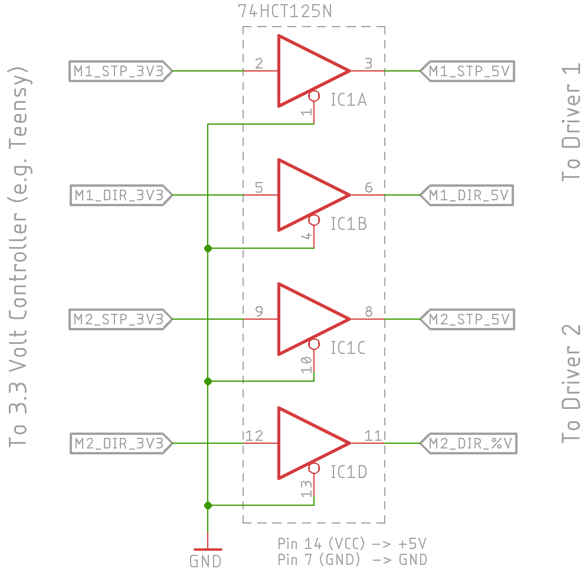
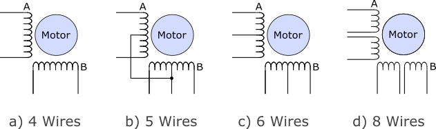
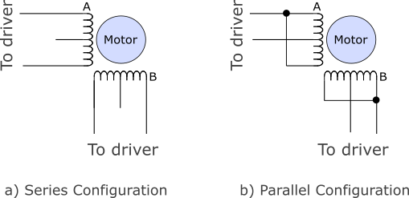

# Motors and drivers

This chapter collects what is needed around the library: which motors and drivers fit, how they are
connected to a Teensy, and how to choose a motor. It is independent of the functions of the library.

## What the library needs

TeensyStep produces two logic signals per motor:

| Signal | |
|---|---|
| STEP | one pulse per step (or microstep) |
| DIR | the direction: one level while the position counts up, the other while it counts down |

and optionally a third one, ENABLE, which switches the motor current on and off
([enable pin](motor-settings.md#the-enable-pin)). Everything else is the job of a stepper driver: it
turns the pulses into currents through the motor coils.

Drivers with a STEP and DIR interface are available for motors of all sizes, from small modules for 1 A
(for example with the DRV8825, A4988 or TMC2209) to industrial drivers for several amperes. Practically
all of them are constant current drivers for bipolar motors, and they can divide the steps of the motor
into microsteps.

## Logic levels

A Teensy 4 has 3.3 V outputs, and its pins do not tolerate 5 V.

- Drivers with 3.3 V compatible inputs can be connected directly: STEP, DIR and GND.
- Drivers with 5 V inputs or opto-coupler inputs need a level shifter. A 74HCT125 contains four buffers
  that accept 3.3 V input signals and produce 5 V output signals, enough for the STEP and DIR signals of
  two motors:

{ width="55%" }

Supply the 74HCT125 from 5 V (pin 14), and connect its enable inputs (pins 1, 4, 10, 13) to GND. A
74HCT245 contains eight buffers and does the same for four motors.

Check the data sheet of the driver for the minimum width of the step pulse and for the time it needs
between a change of DIR and the next step, and set both in the sketch
([hardware settings](motor-settings.md#hardware-settings)). Opto-coupler inputs are slow and often need
pulses of 10 µs or more.

## Motor types

- **Bipolar motors** have two coils and four wires (a). The current through the coils is reversed from
  step to step. Most modern steppers are of this type, and the usual drivers are made for them.
- **Unipolar motors** have a centre tap on both coils. With five wires (b) they can only be driven by
  a unipolar driver, for example four transistors or a ULN2003. The small geared 28BYJ-48 is a popular
  motor of this kind. Such drivers have no STEP and DIR inputs, so these motors cannot be used with the
  library.
- Motors with **six or eight wires** (c, d) can be driven by a bipolar driver. Leave the centre taps of a
  six wire motor unconnected. The coil halves of an eight wire motor can be connected in series (more
  torque at low speed) or in parallel (more torque at high speed):

## Choosing a motor

Motors are usually named by the size of their flange according to the NEMA standard: the number is the
flange size in tenths of an inch.

| NEMA | Flange | Shaft | Typical holding torque |
|:---:|:---:|:---:|:---:|
| 8 | 20 mm | 4 mm | 0.02 to 0.04 Nm |
| 11 | 28 mm | 5 mm | 0.03 to 0.14 Nm |
| 14 | 35 mm | 5 mm | 0.05 to 0.4 Nm |
| 17 | 42 mm | 5 mm | 0.15 to 1.0 Nm |
| 23 | 56.4 mm | 6.35 or 8 mm | 0.4 to 3.4 Nm |
| 34 | 86 mm | 14 mm | 2.5 to 14 Nm |

The data sheet of a motor states, among others:

| Parameter | |
|---|---|
| Rated current | the current per coil for which the motor is made; set the driver to it |
| Resistance, inductance | of one coil. The inductance limits how fast the current can change, and with it the speed |
| Rated voltage | resistance times rated current: the voltage for the rated current at standstill. A constant current driver is supplied with a much higher voltage |
| Holding torque | the torque of the motor at standstill with the rated current |
| Detent torque | the torque without current; it can be felt when turning the shaft by hand |

How to choose:

- **Torque.** Estimate the torque the application needs. A motor with 0.1 Nm lifts a mass of 1 kg on a
  lever of 1 cm, or 0.1 kg on a lever of 10 cm. The torque of a stepper falls with the speed, so leave a
  wide margin.
- **Speed.** For high speeds choose a motor with a low inductance. Such a motor needs a higher current
  for the same torque, so the driver has to be able to deliver it. A higher supply voltage of the driver
  also raises the speed the motor can reach.
- **Microstepping.** More microsteps give a smoother run and a finer resolution, but they multiply the
  step rate: see [Step rates](index.md#speed-and-acceleration).

## Finding speed and acceleration

The values for `setMaxSpeed()` and `setAcceleration()` depend on the motor, its load, the driver and its
supply voltage. They are found by trial:

1. Start with a low acceleration and raise the maximum speed until the motor stalls or loses steps. Use
   about two thirds of that speed.
2. Then raise the acceleration in the same way.
3. Test with the real load, and in both directions if the load is not the same in both, as with a
   vertical axis.

A motor that loses steps is not damaged, but the position the library counts is then wrong until the
machine has found its reference position again ([homing](moving-a-motor.md#homing)).
